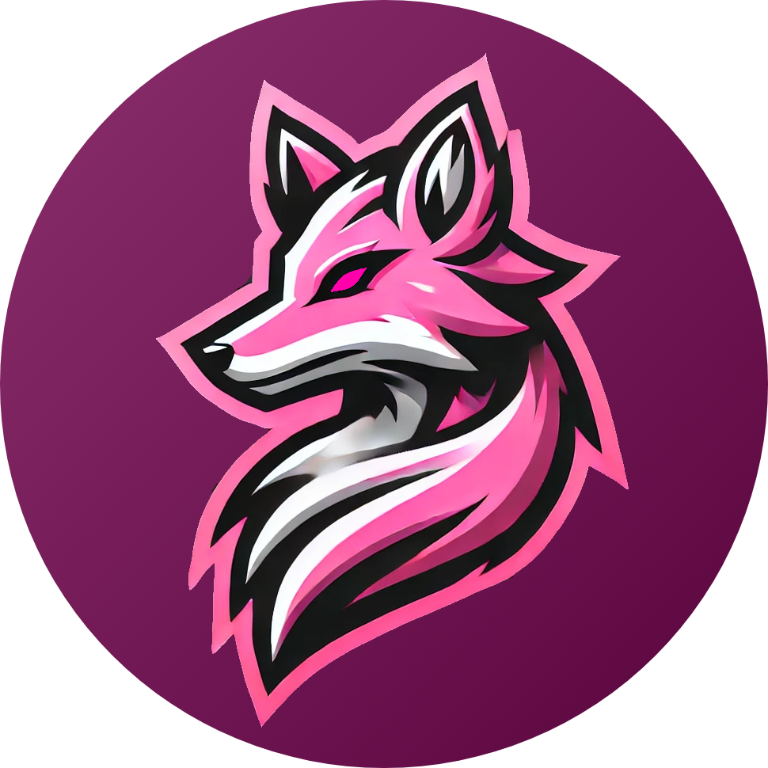
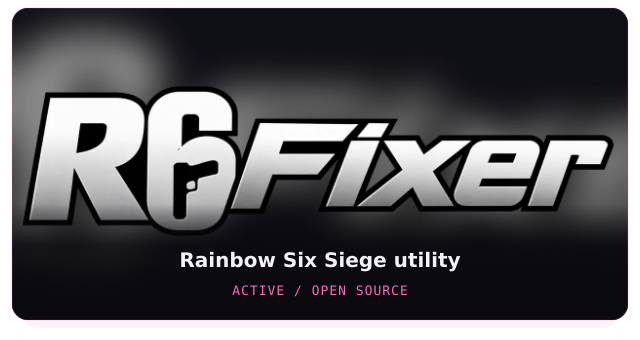
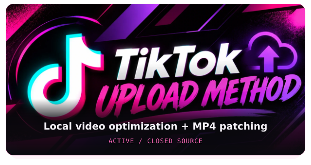
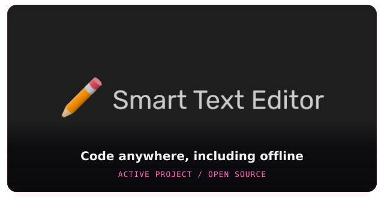
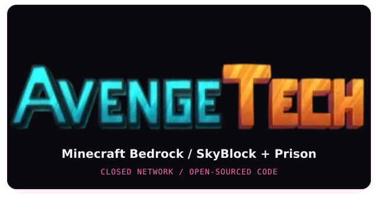

  

  
   
  

  <a href="https://luvvr.net">Website</a> &nbsp; / &nbsp;
  <a href="https://luvvr.net/projects">Projects</a> &nbsp; / &nbsp;
  <a href="https://luvvr.net/tools">Tools</a> &nbsp; / &nbsp;
  <a href="https://luvvr.net/games">Beyond the code</a>

<h2 align="center">About me</h2>

Hey, I'm **luvvr** — a full-stack developer, gamer, and content creator.

I started coding young and found my home in building things people can actually use: web experiences, Discord bots, standalone applications, and practical utilities. My background spans Node.js and discord.js through PHP and PocketMine-MP, including leading development for Minecraft: Bedrock Edition networks.

These days, I bring that same curiosity to useful tools and creative projects. Away from the editor, you'll usually find me playing **Rainbow Six Siege** or creating content.

<h2 align="center">Skills &amp; capabilities</h2>

<h4 align="center">Languages</h4>

  
  
  
  
  
  
  
  
  
  
  
  

<h4 align="center">Frameworks &amp; libraries</h4>

  
  
  
  
  
  

<h4 align="center">Developer tools</h4>

  
  
  
  
  
  

<h4 align="center">Infrastructure &amp; data</h4>

  
  
  
  
  

<h4 align="center">Content creation</h4>

  
  
  
  
  
  
  
  
  

<h2 align="center">My Projects</h2>

  

  <strong>Creator &amp; Lead Developer</strong> 
  A Rainbow Six Siege utility for managing accounts, 
  optimizing and fixing game files, and optimizing network traffic.

  <a href="https://github.com/imluvvr/R6Fixer">Repository</a> &nbsp; / &nbsp;
  <a href="https://github.com/imluvvr/R6Fixer/releases/latest">Latest release</a>

 

  

  <strong>Creator &amp; Developer</strong> 
  Local H.264 optimization and MP4 container patching. 
  Your video stays on your device, with a ready-to-upload download.

<a href="https://luvvr.net/projects/upload-method">Open the tool</a>

 

  

  <strong>Former Concept Designer &amp; Developer</strong> 
  A progressive web app for coding across devices and browsers, 
  including when you're offline.

  <a href="https://stedit.app/">Try the editor</a> &nbsp; / &nbsp;
  <a href="https://github.com/Offroaders123/Smart-Text-Editor">Repository</a>

 

  

  <strong>Former Lead Developer</strong> 
  A Minecraft: Bedrock Edition network featuring SkyBlock and Prison. 
  I helped lead development and open-source its code after closure.

<a href="https://github.com/AvengeTech">Explore the organization</a>

 

  <a href="https://luvvr.net/projects">More of my work</a> &nbsp; / &nbsp;
  <a href="https://luvvr.net/tools">The toolbox</a>

  

Weekly contributions. One project at a time.

<h2 align="center">Elsewhere on the internet</h2>

Different platforms. Same handle.

  <a href="https://luvvr.net"><strong>luvvr.net</strong></a> &nbsp; / &nbsp;
  <a href="https://twitch.tv/imluvvr">Twitch</a> &nbsp; / &nbsp;
  <a href="https://youtube.luvvr.net">YouTube</a> &nbsp; / &nbsp;
  <a href="https://tiktok.luvvr.net">TikTok</a>
    
  <a href="https://x.luvvr.net">X</a> &nbsp; / &nbsp;
  <a href="https://bio.luvvr.net">Biolovers</a> &nbsp; / &nbsp;
  <a href="https://discord.gg/NvDff7XJVX">LUVVR'S PARADISE on Discord</a>

A personal corner of the internet. / <a href="https://luvvr.net">luvvr.net</a>

